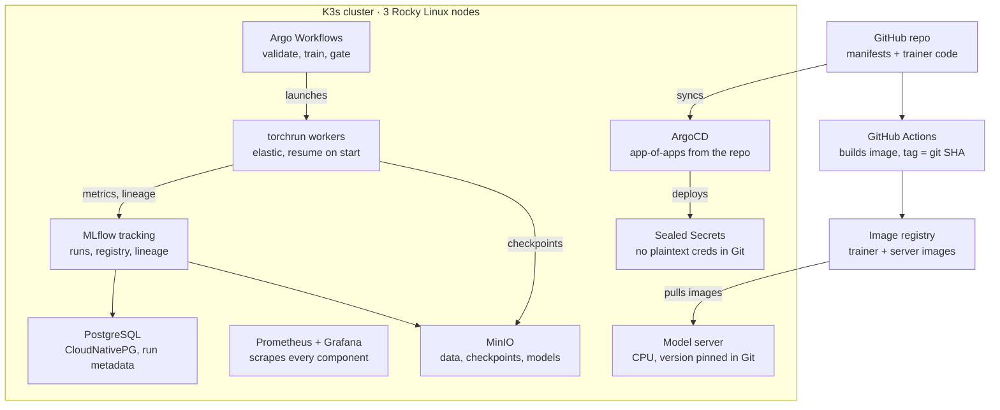
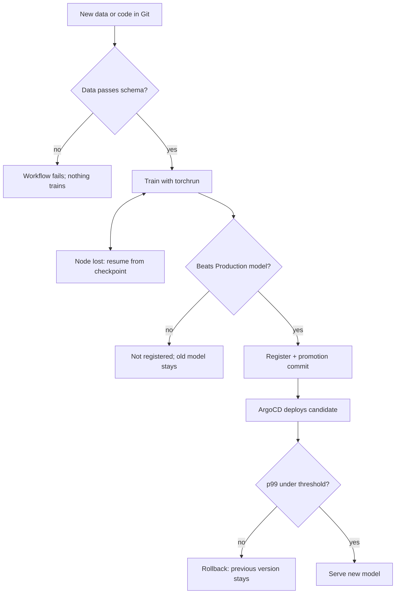

# ML Training Platform — Project Blueprint (Scoped)

## Instructions for Claude Code

This file is the source of truth for the `ml-training-platform` repo. When working in this repo:

- Build in phase order (see **Build phases**). Finish a phase's "Done when" criteria before starting the next one.
- Stay inside the scope table. Do not add components marked **Cut** (Karpenter, Ray, Kubeflow Pipelines, Great Expectations, Triton, OpenTelemetry, GPU exporter) unless asked.
- CPU only. Use a small model and a public dataset; the platform is the point, not the model.
- Everything in the cluster is deployed by ArgoCD from `gitops/`. No manual `kubectl apply` steps in docs or scripts, except the ArgoCD bootstrap.
- No plaintext secrets in Git. Use Sealed Secrets (or External Secrets).
- Never invent metrics, timings, or cost savings in README, docs, or comments. Leave `[X]` placeholders for anything that has to be measured in a drill.
- When a design choice is made (e.g., Argo over KFP, Pandera over Great Expectations), write a short ADR in `docs/adr/`.
- Start with Phase 1: scaffold the repo layout below, the Ansible roles for Rocky Linux + K3s (1 server, 2 agents), the Makefile `bootstrap` target, and the ArgoCD app-of-apps.

## Positioning

This is a platform engineering project that runs ML workloads, not an MLOps research project. It targets mid-level Platform Engineer, Cloud Engineer and SRE roles, where the hiring question is "can this person run stateful, failure-prone workloads on Kubernetes with GitOps and observability?"

What it proves, in order of weight:

1. Training jobs survive node loss and resume from checkpoint, shown in a recorded drill.
2. Every model in the registry traces back to a git SHA, an image digest and a dataset hash.
3. A model only reaches serving if it passes a data gate and a regression gate, enforced in the pipeline, deployed via GitOps.
4. The whole platform is rebuilt from the repo with one bootstrap command.

What it does not claim: enterprise scale, GPU training, cost savings, or ML modelling skill. The model is deliberately small so the platform is the story.

## Scope

Eight of the original fifteen components are cut or swapped for something lighter. Each cut removes something that would need defending in depth without adding new proof.

| Component | Decision | Reason |
| --- | --- | --- |
| K3s on Rocky Linux | Keep | Cheap, local, adds Linux and bare-metal evidence. EKS is an optional phase 6. |
| Karpenter | Cut | AWS/EKS only; doesn't apply to K3s. |
| Kubeflow Pipelines | Replace with Argo Workflows | KFP runs on Argo anyway; Argo is lighter to self-host and is plain Kubernetes YAML. |
| MLflow + Postgres + MinIO | Keep | Core of the lineage story. |
| PyTorch Elastic (`torchrun`) | Keep, CPU only | The resilience story works the same on CPU; no GPU bill. |
| Ray | Cut | Overlaps `torchrun`. One distributed runtime, well understood. |
| Spot instances | Cut (simulate) | Node loss is simulated by draining or killing K3s nodes. Real spot only in optional EKS phase. |
| Great Expectations | Replace with Pandera | One schema check is enough; Pandera is a Python library with no server or data-context setup. |
| Regression gate | Keep | Compare candidate eval metric against current Production model in MLflow. |
| P99 latency gate | Keep, simplified | k6 or `hey` load test against the candidate serving pod; fail if p99 exceeds a set threshold. |
| Triton | Replace with MLflow model server or FastAPI | Triton is GPU-oriented and heavy. A CPU server is honest for a small model. |
| ArgoCD | Keep | GitOps is core to platform roles. |
| Prometheus + Grafana | Keep | Reuse the setup from omni-obs-platform. |
| OpenTelemetry | Cut for v1 | Prometheus metrics cover the story. Add tracing later only if time allows. |
| Prometheus GPU exporter | Cut | No GPUs. |

## Architecture and stack



Everything inside the cluster is deployed by ArgoCD from the repo, so the cluster itself is disposable. Losing a node costs training progress back to the last checkpoint; losing the cluster costs only the rebuild time, as long as Postgres and MinIO are backed up.

## Pipeline topology



The first two gates run inside the Argo Workflow; the latency gate runs after ArgoCD deploys the candidate, so a failure there is a Git revert, not a manual fix. Each failure branch is one of the failure drills below.

## Build phases

Five phases, each ending in something demoable on its own. Stopping after phase 3 still leaves a defensible project.

1. **Cluster and GitOps foundation**
   - 3-node K3s on Rocky Linux (1 server, 2 agents), provisioned with Ansible.
   - ArgoCD app-of-apps bootstrapped from the repo; everything after this is a Git commit.
   - Done when: `make bootstrap` on fresh VMs gives a healthy cluster with ArgoCD synced.
2. **Tracking and storage layer**
   - MinIO (artifacts, checkpoints, datasets), Postgres via CloudNativePG, MLflow tracking server pointed at both.
   - Secrets via Sealed Secrets or External Secrets; no plaintext credentials in Git.
   - Done when: a test run logs params, metrics and an artifact to MLflow, and survives an MLflow pod restart.
3. **Resilient training**
   - Multi-stage Dockerfile for the trainer, image tagged with git SHA, pushed by GitHub Actions.
   - `torchrun` elastic job (PyTorchJob via Training Operator, or a plain Job with a c10d/etcd rendezvous) on a small model and public dataset.
   - Checkpoint to MinIO every N steps; on start, resume from latest checkpoint if present.
   - Every run logs git SHA, image digest, dataset SHA-256, seed and hyperparameters to MLflow.
   - Done when: draining a node mid-training ends with a completed run that resumed from checkpoint (failure drill 1).
4. **Pipeline and gates**
   - Argo Workflows DAG: validate data → train → evaluate → gate → register.
   - Data gate: Pandera schema and basic distribution checks; fail the workflow on violation.
   - Regression gate: candidate metric must match or beat the current Production model in the MLflow registry.
   - Done when: a bad dataset and a worse model are each blocked, with the failing step visible in the Argo UI (drills 2 and 3).
5. **Serving and observability**
   - Promotion = a commit that bumps the model version in the serving manifest; ArgoCD rolls it out.
   - Latency gate: load test against the candidate pod; fail promotion if p99 exceeds the threshold.
   - Grafana dashboards for workflow durations, training step time, checkpoint age, serving latency and error rate.
   - Done when: a model goes from commit to serving with no manual `kubectl`, and a dashboard shows it.
6. **Optional: EKS variant**
   - Reuse production-platform Terraform; run the same manifests on EKS with Karpenter and a spot node pool.
   - Only here can a real spot vs on-demand cost difference be measured.

## Failure drills and evidence

The drills are the proof. Each one gets a short write-up in `docs/drills/`: what was broken, what was expected, what happened, and the evidence.

| # | Drill | How to trigger | Pass condition | Evidence to capture |
| --- | --- | --- | --- | --- |
| 1 | Node loss mid-training | `kubectl drain` or power off a K3s agent during step N | Run completes; logs show resume from checkpoint, not step 0 | Asciinema or screen recording; MLflow run showing one continuous metric curve |
| 2 | Bad data | Commit a dataset with a dropped column or shifted distribution | Workflow fails at validate step; nothing trains | Argo UI screenshot; Pandera error output |
| 3 | Worse model | Train with a deliberately bad hyperparameter | Gate blocks registration; Production model unchanged | MLflow registry screenshot; gate step log |
| 4 | Slow model | Inject a sleep in the serving path | Latency gate fails promotion; ArgoCD keeps previous version | Load-test output with p99; ArgoCD history |
| 5 | Tracking backend outage | Delete the Postgres primary pod | CloudNativePG fails over; MLflow recovers; no run metadata lost | Failover timing from logs; before/after run count |
| 6 | Full rebuild | Destroy the VMs, run bootstrap | Cluster, ArgoCD apps and MLflow return; registry intact from MinIO and Postgres backups | Measured wall-clock rebuild time |

Any numbers used externally come from this table, measured, not estimated: resume time after node loss, failover time, rebuild time.

## Repo layout

```
ml-training-platform/
├── README.md              # what it proves, diagram, links to drills
├── BLUEPRINT.md           # this file
├── Makefile               # bootstrap, destroy, drill-<n>
├── ansible/               # Rocky Linux hardening + K3s install
├── gitops/
│   ├── bootstrap/         # ArgoCD app-of-apps
│   ├── platform/          # MinIO, CloudNativePG, MLflow, Argo Workflows, monitoring
│   └── serving/           # model server manifests (model version pinned here)
├── pipelines/             # Argo WorkflowTemplates: validate, train, eval, gate, register
├── trainer/
│   ├── Dockerfile         # multi-stage, tagged by git SHA
│   ├── train.py           # torchrun entrypoint, checkpoint/resume logic
│   └── validate.py        # Pandera schema
├── loadtest/              # k6 script + p99 threshold
├── .github/workflows/     # build/push image, lint manifests
└── docs/
    ├── adr/               # why Argo over KFP, why CPU, why Pandera
    └── drills/            # one write-up per failure drill
```

## Resume bullets (for later, not for the README)

Use a bullet only once the phase behind it is done. Replace each `[X]` with a measured value; if it wasn't measured, delete the number.

- Built a GitOps-managed ML training platform on a self-hosted K3s cluster (Rocky Linux, Ansible, ArgoCD), with MLflow experiment tracking backed by PostgreSQL and MinIO object storage. *(phases 1–2)*
- Implemented fault-tolerant distributed training with PyTorch Elastic (`torchrun`) and checkpointing to object storage; verified recovery by draining nodes mid-run, with jobs resuming from the last checkpoint in [X] seconds. *(phase 3, drill 1)*
- Automated a training pipeline in Argo Workflows with data validation, model regression and p99 latency gates, blocking promotion of bad data, weaker models and slow builds before deployment. *(phases 4–5, drills 2–4)*
- Established model lineage linking every registered model to its git commit, container image digest and dataset hash, enabling reproducible retraining. *(phase 3)*
- Built Prometheus and Grafana monitoring for pipeline duration, training throughput, checkpoint age and serving latency; documented [N] failure drills with measured recovery times. *(phase 5, drills)*
